# Database ERD

Source of truth: `backend/src/main/resources/db/migration/V1__core_schema.sql` (+ `V2__roles_permissions.sql`).
All timestamps are UTC (`TIMESTAMP WITH TIME ZONE`). Primary keys are UUIDs generated by the application.

```mermaid
erDiagram
  users ||--o{ user_roles : has
  roles ||--o{ user_roles : grants
  roles ||--o{ role_permissions : has
  permissions ||--o{ role_permissions : in
  users ||--o{ refresh_token_sessions : owns
  users ||--o{ password_reset_tokens : requests
  users ||--o| patient_profiles : "is a"
  users ||--o| doctor_profiles : "is a"
  users ||--o{ hospital_staff : works_at
  hospitals ||--o{ hospital_staff : employs
  hospitals ||--o{ hospital_departments : has
  doctor_profiles ||--o{ doctor_hospital_affiliations : affiliated
  hospitals ||--o{ doctor_hospital_affiliations : hosts
  doctor_profiles ||--o{ doctor_availability : offers
  doctor_profiles ||--o{ doctor_verification_records : reviewed
  patient_profiles ||--o{ emergency_contacts : lists
  patient_profiles ||--o{ appointments : books
  doctor_profiles ||--o{ appointments : receives
  patient_profiles ||--o{ medical_records : has
  medical_records ||--o{ medical_record_documents : attaches
  medical_records ||--o| medical_records : amends
  patient_profiles ||--o{ record_access_grants : grants
  doctor_profiles ||--o{ record_access_grants : receives
  patient_profiles ||--o{ medications : takes
  medications ||--o{ medication_reminders : schedules
  medication_reminders ||--o{ medication_adherence_events : records
  patient_profiles ||--o{ emergency_events : raises
  emergency_events ||--o{ emergency_event_locations : located
  emergency_events ||--o{ emergency_event_history : timeline
  emergency_events ||--o{ responder_assignments : staffed
  users ||--o{ accident_detection_events : detects
  accident_detection_events ||--o{ sensor_readings : evidence
  users ||--o{ notifications : receives
  notifications ||--o{ notification_delivery_attempts : delivery
  users ||--o{ device_tokens : registers
  users ||--o{ consent_records : gives
  users ||--o{ ai_processing_records : triggers
```

## Key constraints

| Invariant | Mechanism |
|---|---|
| One account per email | `UNIQUE(users.email)` |
| One patient / doctor profile per user | `UNIQUE(user_id)` |
| No double-booked slot | `UNIQUE(appointments.slot_key)` — populated only while status ∈ {REQUESTED, CONFIRMED} |
| Valid appointment/emergency/verification status | `CHECK` constraints |
| Duplicate emergency retries collapse | `UNIQUE(emergency_events.patient_id, idempotency_key)` |
| Valid coordinates | `CHECK(latitude BETWEEN -90 AND 90)`, `CHECK(longitude BETWEEN -180 AND 180)` |
| Refresh tokens stored hashed only | `token_hash` (SHA-256), `UNIQUE` |
| Reminder dates ordered | `CHECK(end_date IS NULL OR end_date >= start_date)` |
| Availability ranges | `CHECK(end_time > start_time)`, `CHECK(day_of_week BETWEEN 1 AND 7)` |

`emergency_event_history` and `audit_logs` are append-only by convention (the application only inserts); a
database-level immutability trigger is not implemented.
