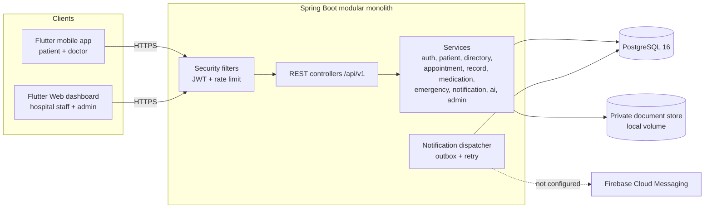
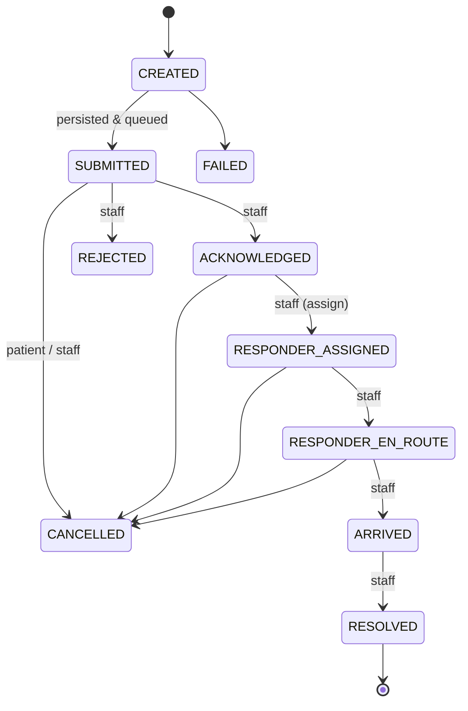

# System Architecture

## 1. Overview

* **Modular monolith**: one deployable, packages with explicit boundaries
  (`auth`, `patient`, `directory`, `appointment`, `record`, `medication`, `emergency`, `notification`, `ai`,
  `sensor`, `admin`, `common`, `security`). Services can later be split along these seams.
* **Data access**: Spring `JdbcClient` with explicit SQL (no ORM), Flyway migrations, constraints enforce invariants.
* **Clients never touch the database** and never supply roles; authorities are loaded server-side per request.

## 2. Backend layering

`Controller (validation, @PreAuthorize) → Service (rules, authorization, audit, transactions) → JDBC → PostgreSQL`

| Concern | Implementation |
|---|---|
| AuthN | BCrypt(12), 15-min JWT access token, opaque rotating refresh token (SHA-256 stored), reuse ⇒ family revoked |
| AuthZ | role → permission mapping in DB; method security + per-object ownership checks in services |
| Validation | Bean Validation on request records; 422 with field map |
| Errors | `GlobalExceptionHandler` → `{code,message,status,timestamp,fields?}`; no stack traces |
| Audit | `audit_logs` written in a separate transaction so denied/failed operations persist |
| Idempotency | `UNIQUE(patient_id, idempotency_key)` for emergencies |
| Double booking | `UNIQUE(slot_key)`, populated only while a slot is held |
| Outbox | `notification_delivery_attempts` PENDING rows processed by a scheduled dispatcher with back-off |
| Rate limiting | in-memory fixed window on auth endpoints (single-instance; see Known Issues) |

## 3. Emergency state machine (authoritative on the backend)

Every transition is an optimistic `UPDATE … WHERE status = :from` plus an append-only row in
`emergency_event_history`. The mobile app shows the status returned by the server; if a refresh fails it labels the
last status as possibly out of date, and if creation fails it shows **"Request NOT confirmed"**.

The workflow is an **in-app demonstration queue**. Emergency contacts are *not* contacted automatically (no SMS/voice
provider is configured) and the history records that fact explicitly.

## 4. Appointment state machine

`REQUESTED → CONFIRMED → COMPLETED`; `REQUESTED → REJECTED`; `REQUESTED|CONFIRMED → CANCELLED`.
Clients cannot submit a status; only the named action endpoints exist.

## 5. Mobile architecture (Flutter)

* `core/` — config, theme (Material 3), network (`ApiClient`: auth header, single-flight token refresh, error mapping),
  storage (`TokenStorage` over the platform keystore), routing (GoRouter + auth/onboarding redirects), shared widgets.
* `features/*` — authentication, onboarding, patient_home, doctor_directory, hospital_directory (screens live in
  `doctor_directory/discover_screens.dart`), appointments, medical_records, medications, emergency, location,
  sensors, notifications, ai_assistant, profile.
* State: Riverpod 3 (`Notifier`, `FutureProvider`). Navigation: GoRouter. HTTP: Dio.
* Models are hand-written `fromJson` classes where a typed model matters (emergency); other responses stay as maps.
  `freezed`/`json_serializable` were not introduced.

## 6. Dashboard

Flutter Web, in-memory tokens (tab close ends session), permission-driven navigation. Pages: overview, emergency
queue (5 s polling, acknowledge/assign/advance/reject), appointments, users & roles, audit log, system status.

## 7. Real-time updates

Polling (5 s) is used. WebSocket/SSE is **not** implemented.

## 8. Deployment topology

`Android app / browser → HTTPS reverse proxy (TLS) → backend container → PostgreSQL`. TLS termination is expected in
front of the backend (see DEPLOYMENT_GUIDE). Private documents are stored on a mounted volume outside any web root.
