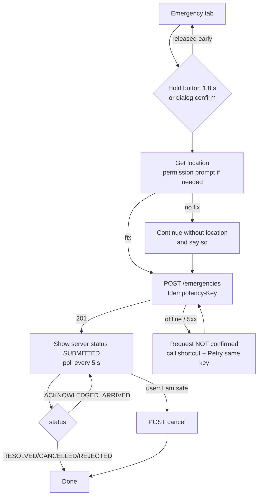
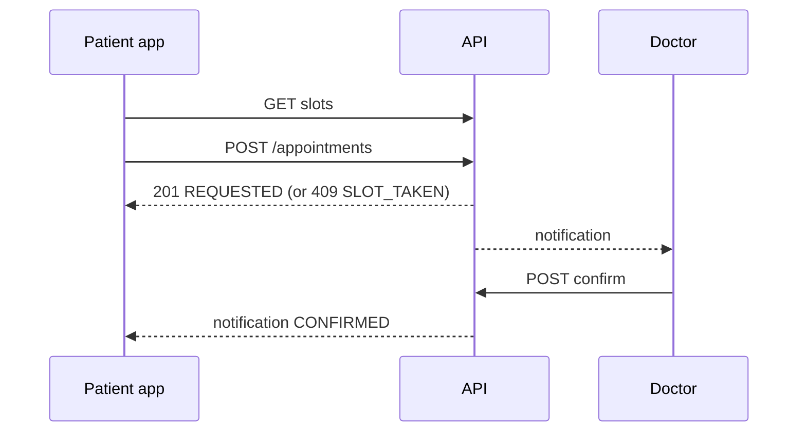

# User Flows

## Emergency (patient)

## Appointment

## Possible-incident (sensors)

`monitoring on → impact ≥ 22 m/s² → rotation ≥ 3 rad/s within 3 s → ≥ 5 s stillness → "Are you OK?" countdown →`
`I'm OK (record) | I need help (create emergency) | expiry (create only if auto-dispatch opted in)`

## Screen inventory (mobile)

Splash · Onboarding · Login · Register · Reset password · Home · Discover (Doctors/Hospitals) · Doctor detail +
booking · Hospital detail · Appointments · Emergency · Safety check · Profile · Health profile · Emergency contacts ·
Safety sensors · Privacy & data · Records · Medications & reminders · Health assistant (Symptoms/Summary/Document) ·
Notifications.

Dashboard: Login · Overview · Emergency queue + event dialog · Appointments · Users & roles · Audit log · System status.
