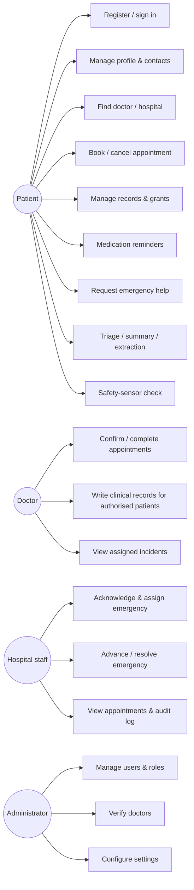

# Use Cases

| ID | Use case | Primary actor | Main flow (summary) | Key alternate / exception flows |
|---|---|---|---|---|
| UC-07 | Request emergency help | Patient | Hold button → location captured (if permitted) → POST with idempotency key → server persists → status SUBMITTED shown → polling | No GPS: sent without location and says so; backend unreachable: "Request NOT confirmed", retry with same key, call shortcut; duplicate retry returns same event; patient cancels (false alarm) |
| UC-13 | Acknowledge & assign | Hospital staff | Open queue → open event → Acknowledge → Assign responder → advance statuses → Resolve | Invalid transition ⇒ 409 shown; event not in staff's hospital ⇒ 404 |
| UC-04 | Book appointment | Patient | Pick doctor → day → free slot → reason → request (REQUESTED) → doctor confirms | Slot taken ⇒ 409, list refreshes; doctor declines ⇒ patient notified |
| UC-11 | Clinical record | Doctor | Patient grants access (or has confirmed visit) → doctor creates note | No relationship ⇒ 404 and audited denial; amend creates new record |
| UC-09 | Safety check | Patient | Impact+rotation+stillness ⇒ "Are you OK?" countdown ⇒ I'm OK / I need help | Countdown expires: sends only if auto-dispatch opted in; else records "not enabled" |
